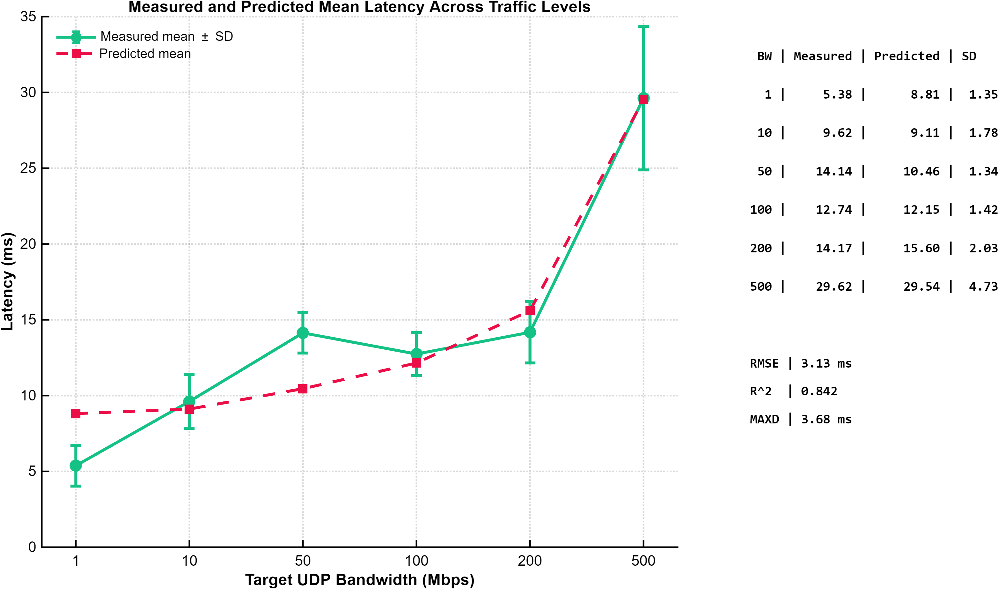

# Private 5G Latency Dataset and Model

Open measurement data and analysis code from an indoor **private standalone 5G network**
(TU Wien IFT TEC-Lab), accompanying the article *Measurement-Driven Modeling of End-to-End
Latency in an Indoor Private Standalone 5G Network*
([Network 2026, 6, 78](https://doi.org/10.3390/network6030078)).

- **245 measurement runs** on a real standalone 5G deployment: 210 UDP one-way latency runs
  (7 indoor locations × 6 target rates from 1 to 500 Mbps × 5 repetitions) and 35 TCP
  throughput runs, 60 s each
- **All raw iPerf 2.2.1 logs**, processed per-trial datasets, and the MATLAB and Python
  code of the modelling and statistical analyses
- **A compact, interpretable latency model** that stays accurate on unseen trials
  ($R^2$ = 0.835) and on unseen locations ($R^2$ = 0.818)

Every 60-s trial from 1 to 200 Mbps had a mean one-way latency below 20 ms; at 500 Mbps,
as traffic approached the practical throughput limit of the setup, every trial exceeded it.

This is version 1.0.1; see [Changes in version 1.0.1](#changes-in-version-101).

---

## Model

The one-way end-to-end latency (ms) at achieved throughput $b$ (Mbps) and location $q$ is

```math
\hat{L}(b,q) = L_0 + \beta\, b + \frac{\theta}{C-b} + \gamma_q, \qquad \gamma_1 = 0
```

| Term | Role | Estimate (Table 5) |
|---|---|---|
| $L_0$ | load-independent latency at the reference location Q1 | 8.639 ms |
| $\beta\, b$ | gradual increase with throughput | $\beta$ = 0.0305 ms/Mbps |
| $\theta/(C-b)$ | queueing-inspired saturation near the effective capacity $C$ | $\theta$ = 486.885 ms·Mbps, $C$ = 611.395 Mbps |
| $\gamma_q$ | offset of location $q$ relative to Q1 | −1.681 to +0.782 ms |

| Validation | MAE (ms) | RMSE (ms) | $R^2$ |
|---|---:|---:|---:|
| In-sample, all 210 runs | 2.52 | 3.13 | 0.842 |
| Trial split (train on trials 1–3, test on 4–5) | 2.654 | 3.269 | 0.835 |
| Leave-one-location-out | 2.622 | 3.369 | 0.818 |

Under both validation schemes the model has lower out-of-sample error than a minimal
M/M/1-type queueing model and a polynomial regression; only a 21-parameter per-location
model is more accurate (Table 6).



*Measured and estimated latency across target UDP traffic rates (Figure 8 of the article,
© 2026 the authors, CC BY 4.0).*

**Five-parameter variant.** The six location offsets can be replaced by a single indicator
for the three locations with metallic equipment and reflective surfaces (Q4–Q6; Section 5.2,
Equation 8):

```math
\hat{L}(b,q) = L_0 + \beta\, b + \frac{\theta}{C-b} + \delta\, \mathrm{Metallic}(q)
```

With half the parameters (5 instead of 10), the accuracy is almost unchanged: trial-split test
$R^2$ = 0.831 (full model 0.835) and leave-one-location-out $R^2$ = 0.812 (0.818). The coefficient
$\delta$ was positive in all seven leave-one-location-out folds (0.009 to 1.055 ms, mean
0.566 ms). The indicator was assigned from the qualitative site characteristics of
Section 3.1, and the analysis is post hoc (`step07_metallic_flag.m`).

The model is calibrated for this deployment under single-user, constant-bit-rate downlink
traffic, and its parameters describe the complete end-to-end path. Applying it to another
network requires new measurements and re-estimation (Section 4.5).

<details>
<summary>Estimation details</summary>

Bounded nonlinear least squares over the $M = 210$ runs (Section 4.3.2):

```math
\min_{L_0,\beta,\theta,C,\gamma_2,\ldots,\gamma_7} \; \sum_{i=1}^{M} \left( L_i - \hat{L}(b_i, q_i) \right)^2
```

```math
0 \le L_0 \le 50, \quad 0 \le \beta \le 5, \quad 0 \le \theta \le 5000, \quad
\max_i(b_i) + 1 \le C \le 5000, \quad -50 \le \gamma_q \le 50
```

</details>

### Fitting the model to your own measurements

`code/fit_latency_model.m` fits the model to other measurements, with any number of
locations. Each element of the three inputs is one measurement run:

```matlab
model = fit_latency_model(location, throughput_Mbps, latency_ms);
```

- `location`: location label (numbers or text); the first location in sorted order, or the
  one given with `Reference=`, has $\gamma = 0$
- `throughput_Mbps`: achieved throughput reported by the receiver, not the target rate
- `latency_ms`: mean one-way latency of the run

`model` contains $L_0$, $\beta$, $\theta$, $C$, the location offsets and the in-sample MAE,
RMSE and $R^2$. `model.predict(b, location)` returns the predicted latency in ms;
`model.predict(b)` uses the mean of the location offsets, as the article does for an
unmeasured location. The bounds above are the defaults and can be changed with name–value
arguments; the function warns if an estimate ends at a bound.

With the data of this package the function reproduces Table 5 (run from `code/`):

```matlab
T = readtable(fullfile('..', 'data', 'latency_with_achieved_bw_210.csv'));
model = fit_latency_model(T.qIdx, T.achieved_Mbps_server, T.latency_ms);
model.predict(100, 1)    % location Q1 at 100 Mbps: 12.64 ms
```

$\theta$ and $C$ are determined mainly by runs close to the throughput limit of the path, so
the measurements should include such rates; in this dataset only the 500 Mbps runs lie in
the steep part of $\theta/(C-b)$ (Figure 6).

The five-parameter variant is fitted by passing the indicator (0 or 1) as `location`; the
offset of the locations with indicator 1 is then $\delta$. With the data of this package this
reproduces the results of Section 5.2.

---

## Contents

The TU Wien Research Data record provides the folders as separate files: `data.zip` and
`code.zip` contain `data/` and `code/`, `raw_latency_logs.zip` and `raw_throughput_logs.zip`
are the two files of `raw/`, and `figure8_measured_vs_predicted_latency.png` is the file of
`docs/`. To run the code, extract `data.zip` and `code.zip` into one folder and place the two
raw archives, without extracting them, in its subfolder `raw/`.

### `data/`: processed datasets

| File | Content |
|---|---|
| `latency_210.csv` | Per-trial one-way latency used for model fitting (210 runs); the three invalid runs are replaced by the cell mean |
| `latency_with_achieved_bw_210.csv` | Latency joined with the achieved throughput predictor |
| `achieved_bandwidth_210.csv` | Achieved throughput parsed from the raw iPerf server reports |
| `latency_trials_raw_210.csv` | Full per-trial summary: achieved throughput, mean/min/max delay, standard deviation, jitter, loss, out-of-order counts, date, validity flag |
| `bandwidth_trials_tcp_35.csv` | Per-trial TCP throughput summary (35 runs) |
| `stage5_trial_level.csv` | Trial-level latency, jitter and loss statistics |
| `stage5_cell_summary.csv` | Per location–rate cell summary (42 cells) |
| `table3_trial_latency_summary.csv` | Median and P95 of trial-level mean latency (Table 3) |
| `table3_trial_latency_bootstrap_ci.csv` | Stratified-bootstrap 95 % confidence intervals (Table 3) |
| `table3_jitter_summary.csv` | Mean jitter by target rate (Table 3) |
| `table3_packet_loss_summary.csv` | Packet-loss statistics by target rate (Table 3) |
| `table3_maximum_delay_summary.csv` | Per-trial maximum delay by target rate (Table 3) |
| `fig5b_threshold_exceedance.csv` | Threshold-exceedance proportions with Wilson intervals (Figure 5b) |

### `raw/`: iPerf output

| File | Content |
|---|---|
| `raw_latency_logs.zip` | 210 UDP client logs (7 locations × 6 target rates × 5 repetitions) |
| `raw_throughput_logs.zip` | 35 TCP client logs (7 locations × 5 repetitions) |

The logs are plain text as written by iPerf on Windows (UTF-16; the 25 UDP logs of
location Q4 at 10–500 Mbps are 8-bit text). The IP addresses of the
sending and receiving hosts are replaced by `CLIENT_IP` and `SERVER_IP`; the logs are
otherwise unmodified.

### `code/`: MATLAB R2025b analysis pipeline, in execution order

| Script | Produces |
|---|---|
| `step01_parse_achieved_bandwidth.m` | Achieved throughput parsed from the raw logs |
| `step02_fit_model.m` | Fit of the proposed model (Table 5) |
| `step03_cross_validate.m` | Trial-based train/test and leave-one-location-out validation (Table 6) |
| `step04_bootstrap_ci.m` | Cell bootstrap, 1000 replicates (Table 5 confidence intervals) |
| `step05_tail_jitter_stats.m` | Trial-level jitter, delay and packet-loss statistics (input to step 09) |
| `step06_gamma_bandwidth_corr.m` | Location offsets vs. location-specific throughput variability (Section 5.2) |
| `step07_metallic_flag.m` | Metallic-environment indicator model (Section 5.2) |
| `step08_baseline_comparison.m` | Baseline models and location-term ablation (Table 6) |
| `step09_urllc_supplementary.m` | Trial-level distributions, bootstrap CIs and threshold exceedance (Section 3.3, Table 3, Figure 5) |
| `step10_imputation_sensitivity.m` | Sensitivity of the 50 Mbps trial-level statistics to the three replaced runs (Section 4.3.1) |

`code/fit_latency_model.m` fits the model to other measurements; see
[Fitting the model to your own measurements](#fitting-the-model-to-your-own-measurements).

`code/figures/` contains the scripts for Figures 5–8 of the article (`make_fig5_...` to
`make_fig8_...`) and the scripts of diagnostic figures (`diag_step*`). The diagnostic figures
and the SVG figures of step 09 are written to `code/figures/diagnostics/`; they are not
figures of the article. Figures 5–8 are computed from the data. The side table of the
published Figure 6 shows θ = 486.84 and C = 611.39 (as in Section 5.1) and 52.59 Mbps at
50 Mbps; computed from the data, these are 486.885 and 611.395 (Table 5) and 52.58 Mbps.

`code/python/` contains an independent re-implementation that reproduces the published
results without MATLAB:

| Script | Purpose |
|---|---|
| `refit_all_models.py` | Refits all five compared models; reproduces Table 5 (point estimates) and Table 6 (test split) |
| `robustness_and_bootstrap.py` | Refit without the three invalid runs (M = 207) and the cell bootstrap of Table 5, with the same resampling as MATLAB `rng(42)` |
| `verify_optimizer_settings.py` | Confirms that the optimizer settings of Section 4.3.2 (initial vector, bounds, multi-start values of C) reproduce the published estimates |

---

## Measurement summary

- **Tool:** iPerf 2.2.1, enhanced-report mode (`-e`), 60 s per run, 1 s reporting interval
- **Latency:** UDP, 1470-byte datagrams, 7 locations × 6 target rates (1, 10, 50, 100, 200,
  500 Mbps) × 5 repetitions = 210 runs
- **Throughput:** TCP, 7 locations × 5 repetitions = 35 runs
- **Campaign dates:** latency 27 June – 3 July 2025; throughput 27 June and 1 July 2025
- **Measurement points:** seven fixed indoor locations beneath or near the distributed pico
  radio units (pRRUs) of the deployment
- **Path measured:** complete end-to-end path between a wired campus host and a 5G-attached
  endpoint, including campus routing and firewall functions, the private 5G core and radio
  access network, the customer premises equipment, and the IEEE 802.11ax link between the
  CPE and the receiving host
- Models are fitted using the **achieved** throughput reported by iPerf, not the configured
  target rate

---

## Known data issue

Three runs (location Q1, 50 Mbps, repetitions 3–5) returned invalid one-way delay values:
iPerf reported delays close to 4.29 × 10^6 ms (2^32 µs), which is consistent with negative
one-way delays wrapped around in a 32-bit counter, as can occur when the clocks of the two
hosts are offset. These runs are flagged by `valid_owd = 0` in `data/latency_trials_raw_210.csv` and
were replaced by the cell mean in `data/latency_210.csv`. Refitting the model without them
(`code/python/robustness_and_bootstrap.py`) changes the model parameters by less than 4.4 %
and the mean absolute error by 0.02 ms; `step10_imputation_sensitivity.m` quantifies the
effect on the trial-level statistics at 50 Mbps. See Section 4.3.1 of the article.

---

## Requirements

**MATLAB pipeline**, the analysis reported in the article (`code/`, `code/figures/`):

- MATLAB **R2025b** with the Optimization Toolbox (`lsqcurvefit`) and the Statistics and
  Machine Learning Toolbox (`corr`, `nlparci`, `prctile`)
- Tested with MATLAB R2025b (Update 7) on Windows 11
- In MATLAB, go to the `code/` folder and run `run_all`. It runs steps 01–10 and the MATLAB
  figure scripts in order. Inputs are read from `data/` and `raw/`; outputs are written to
  `code/` and `code/figures/`. The steps can also be run one by one in the same order.

**Python verification scripts** (`code/python/`), an optional and independent re-implementation
that reproduces the reported parameter estimates without MATLAB:

- Tested with **Python 3.14.6** on Windows 11, using both **NumPy 2.4.6** and
  **NumPy 2.5.2**; results agree between the two NumPy versions to at least six
  significant figures
- NumPy is the only third-party dependency; everything else is from the standard library.
  See `code/python/requirements.txt`
- From `code/python/`, run:

      python -m pip install -r requirements.txt    # only if NumPy is missing
      python refit_all_models.py
      python robustness_and_bootstrap.py
      python verify_optimizer_settings.py

  All paths are resolved relative to the script location, so the archive can be extracted
  anywhere.

---

## Changes in version 1.0.1

- MATLAB scripts renamed from `01_...m` to `step01_...m` (MATLAB does not accept names that
  begin with a digit); input paths point to `data/` and `raw/` instead of folders of the
  original working directory; `step08` no longer reads an intermediate file that is not part
  of the package; `code/run_all.m` runs the complete pipeline.
- `code/fit_latency_model.m`: fits the model to other measurements, with any number of
  locations.
- IP addresses in the raw logs replaced by `CLIENT_IP` and `SERVER_IP`; all values parsed
  from the logs are unchanged.
- `code/figures/`: scripts for Figures 5–8 of the article; the diagnostic scripts of version
  1.0.0 (`make_stage*`) renamed to `diag_step*` and made to run from the package; step 09
  writes its SVG figures to `code/figures/diagnostics/` as `step09_*.svg` instead of
  `fig1_*.svg` to `fig6_*.svg`, which were not figures of the article.
- `code/python/`: English output; the minimal M/M/1-type baseline is fitted with the bounds
  of Section 4.3.2; the bootstrap uses the same resampling as MATLAB.
- Comments and console output of the MATLAB scripts no longer refer to internal revision
  stages.
- README: model overview, requirements, table numbers of the article, the article in the
  citation, and corrected measurement details.

The processed data, the numerical settings and the results are unchanged.

---

## Citation

This dataset is archived in the TU Wien Research Data repository. The article cites
version 1.0.0, https://doi.org/10.48436/hja53-s8y18; https://doi.org/10.48436/s7hpj-7c465
always resolves to the latest version.

When using these data, please cite both the dataset and the associated article:

- Bodur, O.; Çağlayan, S.; Demir, N.; Poszvek, G.; Bleicher, F. Measurement-Driven Modeling of
  End-to-End Latency in an Indoor Private Standalone 5G Network. *Network* **2026**, *6*, 78.
  https://doi.org/10.3390/network6030078
- Bodur, O.; Çağlayan, S.; Demir, N.; Poszvek, G.; Bleicher, F. Measurement dataset and analysis
  code for "Measurement-Driven Modeling of End-to-End Latency in an Indoor Private Standalone 5G
  Network". TU Wien Research Data, 2026. https://doi.org/10.48436/hja53-s8y18

---

## License

This record is dual-licensed:

| Part | Contents | License |
|---|---|---|
| **Data** | `data/`, `raw/`, this README | Creative Commons Attribution 4.0 International (CC BY 4.0) |
| **Code** | `code/`: all MATLAB `.m` and Python `.py` scripts | MIT License |

Creative Commons licenses are not intended for software, so the analysis code carries a
dedicated software license. See `LICENSE.md` in the record, or `LICENSE-MIT.txt` inside
`code.zip`, for the full license texts.
